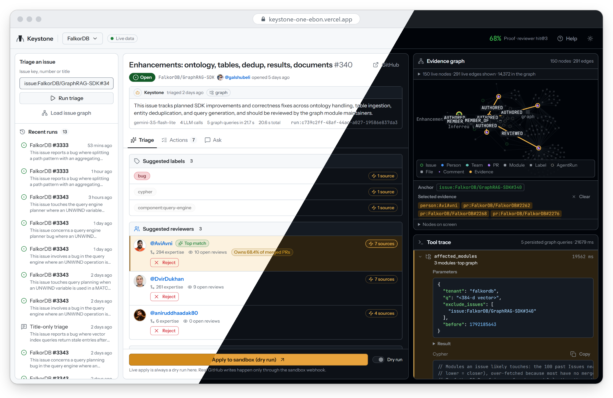
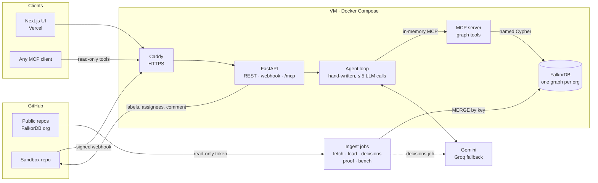
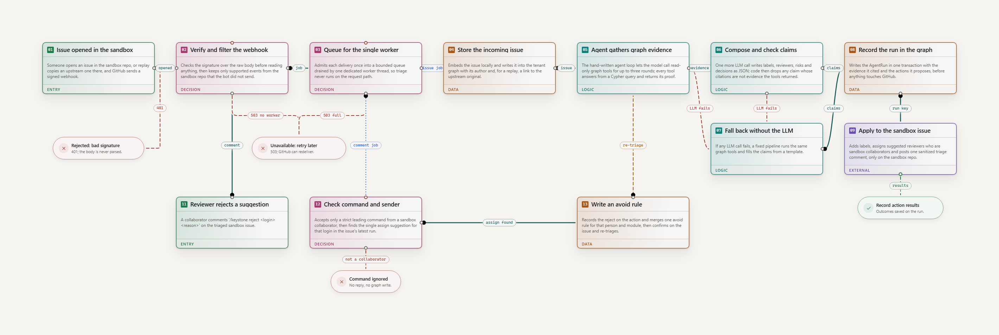
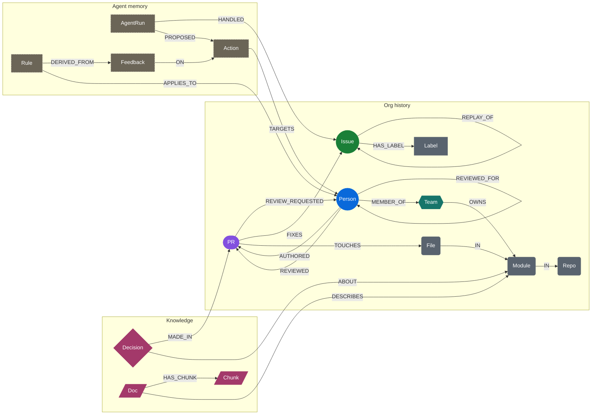

<p align="center">
  <picture>
    <source media="(prefers-color-scheme: dark)" srcset="docs/assets/logo-dark.svg">
    
  </picture>
</p>

<h1 align="center">Keystone</h1>

<p align="center">
  <b>Issue triage that shows its work.</b><br>
  A triage agent for open-source orgs, built on a FalkorDB graph of the org's GitHub history.<br>
  Every claim it makes carries the graph path and the Cypher that prove it.
</p>

<p align="center">
  <a href="https://keystone-one-ebon.vercel.app"></a>
  <a href="https://github.com/Ishaan2053/keystone/actions/workflows/ci.yml"></a>
  
  
  
  
  
</p>

<p align="center">
  <a href="https://keystone-one-ebon.vercel.app">Live demo</a> ·
  <a href="#try-it-in-10-seconds">Try the MCP server</a> ·
  <a href="#proof">Proof</a> ·
  <a href="docs/graph.md">Graph model</a> ·
  <a href="docs/operations.md">Operations</a>
</p>

<p align="center">
  <a href="https://keystone-one-ebon.vercel.app"></a>
</p>

## What it does

When an issue is opened on a repo, Keystone reads the org's history from the graph and, with no button pressed:

- **finds the code it touches**, by walking from the nearest past issues through the PRs that fixed them to the files and modules they changed;
- **ranks reviewers** by how much they authored and reviewed in that code, divided by their open review load;
- **surfaces past decisions** from merged PRs and design docs, each kept only if its quote is verbatim in the source;
- **flags bus-factor risk** when one person wrote most of a module;
- **applies the triage** (labels, assignees and a cited comment) to a sandbox repo, live, through a signed GitHub webhook;
- **learns from maintainers**: `/keystone reject <login> <reason>` on the issue becomes a `Rule` node that changes the next ranking inside the graph query.

Each claim in the triage links to its evidence: the stable node keys, the path between them on the canvas, and the exact Cypher and parameters that returned them. A claim with no evidence is dropped before it is shown. You can also ask questions about the org's history ("Why does GraphRAG-SDK do X?") and get answers that cite decisions, PRs and docs.

## Why a graph

Triage questions are joins across things no single table holds: issue text to the PRs that fixed similar issues, to the files they touched, to the people who wrote and reviewed them, to the decisions made about that code, to what maintainers said last time. In Keystone each of those is one Cypher query over one tenant graph, and the product does not work without FalkorDB:

- **Vector search starts the walk, edges finish it.** FalkorDB's vector indexes find the nearest issues, decisions and doc chunks; the same query then follows `FIXES`, `TOUCHES` and `IN` to code.
- **Graph algorithms run in the database.** `algo.pageRank`, `algo.betweenness` and `algo.labelPropagation` over the review graph score people and infer teams; `algo.SPpaths` returns the shortest evidence path behind a claim.
- **Memory lives in the same graph.** Each triage is an `AgentRun` wired to every node it cited; feedback becomes `Rule` nodes that `rank_reviewers.cypher` reads on the next run.

Every query is a named file in [`cypher/`](cypher/), always run with parameters. [docs/graph.md](docs/graph.md#cypher) says what each one does and why it needs a graph.

## Try it in 10 seconds

The six read-only graph tools are served over MCP at a public endpoint, no auth needed (the data is public). Add this to `.cursor/mcp.json`, or your client's equivalent:

```json
{"mcpServers":{"keystone":{"url":"https://35-244-53-175.sslip.io/mcp"}}}
```

Then try:

1. "Use rank_reviewers for tenant falkordb, module module:FalkorDB/FalkorDB/src/execution_plan, k 3. Explain each suggestion using only returned evidence keys."
2. "For tenant falkordb, use affected_modules on 'Crash with OPTIONAL MATCH', then bus_factor on the top module. Cite the returned evidence; say if none is found."
3. "For tenant falkordb, use find_decisions to explain query timeout configuration. Cite its source URLs and evidence keys; do not invent a decision if the result is empty."

Each result is a `ToolResult`: the data, plus the Cypher, its parameters, the evidence keys and the time it took. Calls are limited to 30 a minute per IP, and `apply_triage` is never exposed over HTTP. Details are in [docs/operations.md](docs/operations.md#hosted-mcp-over-https).

## How it works



1. **Ingest.** `ingest/` fetches the public history of the org's repos with a read-only token and loads it into `tenant_<slug>`: people, PRs, issues, files, modules, comments, labels and docs, with local `all-MiniLM-L6-v2` embeddings. A one-off LLM job extracts past decisions from PR threads and design docs, and keeps each only if its quote is verbatim in the source.
2. **Trigger.** An issue opened on the sandbox repo sends a signed webhook. The API checks the HMAC on the raw body, drops duplicates and bot events, and queues one job for a single worker.
3. **Triage.** The agent is a hand-written loop, with no agent framework. It calls its own MCP server through an in-memory client, so the agent and any external client use the same tools. The model picks tools for at most three rounds, then writes the claims as JSON. Code then checks them: every citation must be a key some tool returned as evidence, reviewers must be people `rank_reviewers` scored, and unsupported claims are dropped. If the LLM fails, a fixed pipeline fills the same claims from a template.
4. **Record and act.** The run is written to the graph as an `AgentRun` with its evidence and proposed `Action`s, then applied to the sandbox repo. Writes to any other repo are refused in code.
5. **Learn.** A collaborator's `/keystone reject` writes `Feedback` and an avoid `Rule`, and re-triages. `/keystone why <login>` replies with the stored evidence path to that person.

### The triage flow

<p align="center">
  <a href="docs/assets/triage-flow.png"></a>
</p>

<sub>Mapped from the code with <a href="https://hqflow.vercel.app">HQFlow</a>; click for full size. The top row is the issue path, the bottom row the <code>/keystone reject</code> loop and the failure outcomes.</sub>

## The graph

Each org is one FalkorDB graph, `tenant_<slug>`. The demo tenant, `tenant_falkordb`, is built from FalkorDB/FalkorDB, FalkorDB/GraphRAG-SDK and FalkorDB/falkordb-browser: about 14,400 nodes and 39,000 edges on 2026-10-18. Every node has a stable `key` such as `person:octocat` or `pr:FalkorDB/FalkorDB#123`; evidence, citations and the UI use keys, never FalkorDB internal ids.



<sub>Colours match the entity colours in the UI. Comments (`WROTE`, `ON`) and `AgentRun -USED_EVIDENCE-> any node` are left out for readability.</sub>

A few rules shape the data:

- **Bots are not people.** Review bots write about half of all reviews and would top every ranking, so bot accounts get no `Person` node and their comments aren't loaded.
- **Sweeps carry no expertise.** A PR touching more than 300 files, or a release merge such as `staging` into `main`, keeps every edge except `TOUCHES`.
- **Teams are inferred.** FalkorDB's own CODEOWNERS covers only `/build/` and `/.github/`, so label-propagation communities in the review graph become `team:inferred/<n>` teams.
- **A load never drops the graph**, because the graph also holds agent memory.

The node and relationship tables, load counts and the full query inventory are in [docs/graph.md](docs/graph.md).

## Proof

`python -m ingest.proof --tenant falkordb` scores the graph and two baselines on 50 held-out closed issues; each method sees only history from before the issue was opened. These are the numbers as they came out (`data/proof/falkordb.json`, served by `/stats` and shown in the UI's Proof panel):

| Metric | Graph (Keystone) | CODEOWNERS | Similar issues (vector only) |
| --- | --- | --- | --- |
| Reviewer hit@3 | 0.68 | **0.74** | 0.72 |
| Module hit@1 | 0.54 | 0.10 | **0.56** |
| Module hit@3 | **0.70** | 0.56 | **0.70** |
| Label precision@2 | 0.34 | 0.32 | **0.43** |

- **Where the graph wins:** modules against CODEOWNERS, 0.54 vs 0.10 at hit@1 (5.4×). FalkorDB's CODEOWNERS covers only `/build/` and `/.github/`, so that baseline falls back to the most-changed modules. Example: for [FalkorDB#2868](https://github.com/FalkorDB/FalkorDB/issues/2868) ("aggregate open dependabot PRs into one PR") the graph's top module is `.github`, which the fix touched; the nearest similar issue points into `src/`.
- **Where it ties or loses:** against vector search it ties on modules (0.54 vs 0.56 at hit@1, 0.70 each at hit@3), trails slightly on reviewers (0.68 vs 0.72), and loses on labels (0.34 vs 0.43). Example loss: [FalkorDB#1538](https://github.com/FalkorDB/FalkorDB/issues/1538) ("allow UDFs to log similar to console.log") was fixed in `src/udf`; the nearest similar issue went straight there, while the graph ranked `deps` first.
- **What the graph adds is not raw accuracy.** On this sample it is about as accurate as vector search. What vector search cannot do is back each claim with the Cypher and evidence path that prove it, turn maintainer feedback into rules that change the next ranking, or flag ownership risk through bus factor.

Query latency, from `python -m ingest.bench` (50 warm runs per tool, `data/bench/falkordb.json`):

| Tool | p50 | p95 |
| --- | ---: | ---: |
| `affected_modules` | 10.8 ms | 13.3 ms |
| `rank_reviewers` | 28.5 ms | 33.8 ms |
| `bus_factor` | 2.9 ms | 3.2 ms |
| `find_decisions` | 9.7 ms | 16.0 ms |
| `explain_path` | 48.0 ms | 75.8 ms |
| `recall_run` | 3.3 ms | 4.6 ms |

End-to-end triage takes 10 to 40 s, almost all of it the LLM writing the triage.

## Hackathon tracks

Keystone is built for Graph Hacks: Context for AI Agents (WeMakeDevs x FalkorDB) and is entered in three tracks: -

- **Track 1, "Agents That Act on Connected Data" (headline).** A signed GitHub webhook on the sandbox repo triggers the agent, which triages the new issue from the tenant graph and applies the result (labels, assignees and a triage comment) to `SANDBOX_REPO` only.
- **Track 3, "Company Brain".** The decisions job extracts past decisions from merged PRs and design docs (kept only when their quote is verbatim), and `ask` answers questions over that org history with citations to graph keys.
- **Track 2, "Agent Memory".** Each triage is recorded as an `AgentRun` in the tenant graph, and a reject (`POST .../feedback` or `/keystone reject`) becomes an avoid `Rule` there that `rank_reviewers.cypher` applies on later triages.

## Quick start

Requires Docker, Python 3.11+ and Node.js. Copy `.env.example` to `.env` and set at least `FALKORDB_PASSWORD` and a read-only `GITHUB_TOKEN`.

```bash
docker compose up -d falkordb                  # FalkorDB on 127.0.0.1:6379

python3 -m venv .venv && source .venv/bin/activate
pip install -r requirements.txt

python -m ingest.fetch --tenant falkordb       # GitHub -> data/raw/falkordb/*.json (cached)
python -m ingest.load --tenant falkordb        # data/raw -> graph tenant_falkordb
python -m ingest.decisions --tenant falkordb   # LLM job, cached on disk; needs GEMINI_API_KEY
python -m ingest.proof --tenant falkordb       # graph vs baselines -> data/proof/
python -m ingest.bench --tenant falkordb       # query latency -> data/bench/

API_MODE=live uvicorn api.main:app --port 8000 # API on :8000
python -m api.agent --tenant falkordb --issue 'issue:FalkorDB/FalkorDB#3343'  # triage one issue from the CLI

cd web && npm ci && npm run dev                # UI on :3001; set NEXT_PUBLIC_DATA_SOURCE=api in web/.env.local
```

Without a graph, the API and UI also run on curated fixtures (`API_MODE=fixtures`, the default). Tests: `pytest -q`, and `npm run test:e2e` in `web/`.

[docs/operations.md](docs/operations.md) covers the environment variables, the full Compose stack with Caddy, deploying to a VM, the GitHub webhook setup and `/keystone` commands, and the hosted MCP endpoint.

## Project layout

```text
api/        FastAPI app, agent loop, MCP server and tools, webhooks, GitHub actions, memory, schemas
ingest/     GitHub fetcher, loader, embeddings, decisions job, replay, proof and bench
cypher/     every query the product runs, one .cypher file each
web/        Next.js UI (App Router, shadcn/ui, react-force-graph-2d)
design/     design tokens and visual rules
docs/       spec, build plan, graph reference, operations
```

## Safety

- **Public data only.** Keystone stores GitHub logins, display names and profile URLs, never emails, even from commit metadata.
- **Sandbox-only writes.** Labels, assignees and comments go only to the repo in `SANDBOX_REPO`; the code refuses any other target. The public `POST /apply` route is dry-run only and answers `403` to a live write.
- **Verified triggers.** Webhooks without a valid HMAC signature are rejected, and `/keystone` commands are accepted only from collaborators on the sandbox repo.
- **No backlinks.** Text written to the sandbox has its @-mentions and cross-repo references turned into code spans, so upstream maintainers are never pinged.
- **A fixed LLM budget.** At most 5 LLM calls per triage, enforced in code, with every response cached on disk. Embeddings run locally.

## Docs

- [docs/spec.md](docs/spec.md): graph model, tool contracts, agent and memory loops
- [docs/graph.md](docs/graph.md): node and relationship reference, load counts and every Cypher query
- [docs/operations.md](docs/operations.md): environment, Compose, deployment, webhooks, hosted MCP
- [docs/tasks.md](docs/tasks.md): the four-day build plan
- [design/README.md](design/README.md): the visual system

## Team

Built by [@Ishaan2053](https://github.com/Ishaan2053) (ingest, graph queries, tools, agent, memory, proof) and [@prnvtripathi](https://github.com/prnvtripathi) (infrastructure, API, web UI, webhooks, actions, hosted MCP).

## AI use

Keystone is built with the help of Claude Code, superseded by the developers' own engineering efforts and judgement: in both lanes the AI-assisted work was directed, reviewed and verified by the developers, and each task's "done when" check was run before review.
